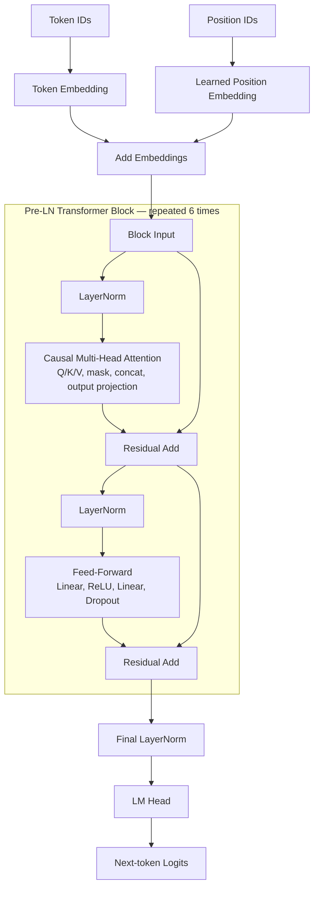

# MiniGPT — Decoder-only Transformer in PyTorch

A compact character-level language model for understanding and validating GPT internals through training, checkpointing, and autoregressive generation on Tiny Shakespeare.

**Tech Stack:** Python · PyTorch · NumPy · tqdm · pytest

## 1. Model Architecture



Each block preserves the embedding dimension; the feed-forward network expands it from 384 to 1536 and projects back to 384. Attention uses a lower-triangular causal mask and `1 / sqrt(d_k)` scaling, where `d_k` is the per-head Q/K dimension.

## 2. Core Components

| Component | Implementation |
| --- | --- |
| Character-level tokenizer | Builds a sorted character vocabulary with reversible character-to-ID mappings. |
| Causal attention | Handwritten Q/K/V projections, scaled dot products, causal masking, and concatenated head outputs. |
| Transformer blocks | Pre-LayerNorm attention and ReLU feed-forward sublayers, each with a residual connection. |
| Next-token prediction | Inputs and targets are shifted by one character; cross-entropy is computed from vocabulary logits. |
| Generation | Crops context, uses the last timestep, applies temperature and optional top-k filtering, then samples and appends one token. |

## 3. Training & Validation

The included `data/input.txt` is Tiny Shakespeare, with a [dataset reference in karpathy/char-rnn](https://github.com/karpathy/char-rnn/tree/master/data/tinyshakespeare). Training uses a contiguous **90/10 train-validation split** and derives the vocabulary from the data.

Current defaults in `config.py`:

| Setting | Value |
| --- | --- |
| Embedding dimensions | 384 |
| Attention heads / head dimension | 6 / 64 |
| Transformer layers | 6 |
| Context length | 256 characters |
| Dropout | 0.2 |

Training uses AdamW with a learning rate of `3e-4` and batch size 64. **The default 20 optimizer updates are for smoke training only.** Train/validation loss is evaluated initially, periodically, and after the final update; logged steps count completed optimizer updates.

No formal training benchmark, perplexity result, or attention-scaling ablation is reported.

## 4. Key Engineering Work

This version builds on [HaoPan036/Mini-GPT](https://github.com/HaoPan036/Mini-GPT). Changes to the upstream foundation include:

- **Per-head attention scaling:** use `k.size(-1) ** -0.5` rather than the input embedding dimension; the current head dimension is 64.
- **Seed reproducibility:** seed Python, NumPy, and PyTorch CPU/CUDA with `seed=42` before initialization and batch sampling.
- **Checkpoint/evaluation alignment:** evaluate after the final optimizer update, then save the matching parameters with step and seed metadata.
- **Input validation:** check head count/divisibility, sequence length, positive temperature, and positive integer top-k values.
- **10 core correctness tests:** cover tokenizer round trip, attention/GPT shapes, causal masking, finite loss, checkpoint reload, numerical attention, and input constraints.

The numerical test compares a Head with `n_embd=12`, `head_size=4`, and dropout disabled against an explicit scaled dot-product calculation, so embedding-dimension scaling cannot pass unnoticed.

## 5. Quick Start

Python 3.12 was used for local verification. From the project root, create and activate an environment, then install dependencies:

```powershell
python -m venv .venv
.\.venv\Scripts\Activate.ps1
python -m pip install -r requirements.txt
```

On Linux/macOS, activate with `source .venv/bin/activate` instead.

```bash
python train.py
python generate.py --prompt "ROMEO:" --max_new_tokens 200
python -m pytest
```

Training creates local `ckpt.pt`; run it before generation. Prompts must use the saved tokenizer's characters. Checkpoints and local environments are Git-ignored; tests use temporary checkpoint files.

## 6. Project Structure

```text
mini-gpt-pytorch/
├── model.py              # Attention, Transformer blocks, language model
├── train.py              # Training, validation, checkpoint saving
├── generate.py           # Checkpoint loading and text generation CLI
├── utils.py              # Character-level tokenizer
├── config.py             # Model/training defaults and seed
├── requirements.txt
├── data/input.txt        # Tiny Shakespeare
├── tests/test_core.py    # 10 core correctness tests
├── README.md
└── .gitignore
```

## 7. Limitations & Attribution

- Character-level tokenization and a 256-character context limit the sequence representation and available history.
- The small model and 20-update default support pipeline verification; they do not establish language-generation quality.
- This is a next-token language model, not an instruction-tuned chatbot or question-answering assistant.
- Fixed seeds provide basic reproducibility; results can differ across devices and library versions.

The original model and training pipeline come from [HaoPan036/Mini-GPT](https://github.com/HaoPan036/Mini-GPT). Personal project work is the scaling correction, reproducibility, evaluation alignment, validation, tests, and documentation listed above; the full Transformer implementation is not claimed as independently original. AI coding assistance was used.

The upstream README mentions MIT, but this checkout has no standalone `LICENSE` file. No new license is assigned here. Upstream licensing and redistribution permissions must be clarified before public redistribution; attribution alone does not establish permission.

References retained from upstream:

- [Attention Is All You Need](https://arxiv.org/abs/1706.03762)
- [Language Models are Unsupervised Multitask Learners](https://d4mucfpksywv.cloudfront.net/better-language-models/language_models_are_unsupervised_multitask_learners.pdf)
- [nanoGPT](https://github.com/karpathy/nanoGPT)
- [The Illustrated Transformer](https://jalammar.github.io/illustrated-transformer/)
