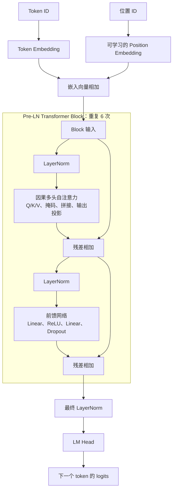

[English README](README.md)

# MiniGPT — 基于 PyTorch 的 Decoder-only Transformer

一个字符级小型语言模型，使用 Tiny Shakespeare 数据集，通过训练、检查点保存和自回归生成，理解并验证 GPT 的内部机制。

**技术栈：** Python · PyTorch · NumPy · tqdm · pytest

## 1. 模型架构



每个 Block 保持嵌入维度不变；前馈网络将维度从 384 扩展到 1536，再投影回 384。注意力使用下三角因果掩码和 `1 / sqrt(d_k)` 缩放，其中 `d_k` 是单个注意力头的 Q/K 维度。

## 2. 核心组件

| 组件 | 实现说明 |
| --- | --- |
| 字符级 tokenizer | 按排序后的字符集合构建词表，支持字符与 ID 的双向映射。 |
| 因果注意力 | 手写 Q/K/V 投影、缩放点积、因果掩码和多头输出拼接。 |
| Transformer Block | 注意力和 ReLU 前馈子层均采用 Pre-LayerNorm，并分别保留残差连接。 |
| 下一个 token 预测 | 输入与目标错开一个字符，根据词表 logits 计算交叉熵损失。 |
| 文本生成 | 裁剪上下文，取最后一个时间步，应用 temperature 和可选 top-k，再采样并追加一个 token。 |

## 3. 训练与验证

项目内的 `data/input.txt` 为 Tiny Shakespeare，数据参考见 [karpathy/char-rnn](https://github.com/karpathy/char-rnn/tree/master/data/tinyshakespeare)。训练按原始序列顺序进行 **90/10 训练集与验证集切分**，词表由数据中的字符动态构建。

`config.py` 中的当前默认配置：

| 配置项 | 数值 |
| --- | --- |
| 嵌入维度 | 384 |
| 注意力头数 / 每头维度 | 6 / 64 |
| Transformer 层数 | 6 |
| 上下文长度 | 256 个字符 |
| Dropout | 0.2 |

训练使用 AdamW，学习率为 `3e-4`，batch size 为 64。**默认 20 次 optimizer update 仅用于 smoke training，即检查训练流程能否正常运行。** 训练集与验证集损失会在开始时、训练过程中及最后一次更新后评估；日志中的 step 表示已完成的参数更新次数。

本项目尚未报告正式训练基准、Perplexity 结果或注意力缩放对照实验。

## 4. 主要工程改进

本版本基于 [HaoPan036/Mini-GPT](https://github.com/HaoPan036/Mini-GPT)，在原项目基础上完成了以下修改：

- **单头维度缩放修正：** 使用 `k.size(-1) ** -0.5`，以单个头的 Q/K 维度替代输入嵌入维度；当前每头维度为 64。
- **随机种子与可复现性：** 在初始化和 batch 采样前，使用 `seed=42` 设置 Python、NumPy、PyTorch CPU 及可用 CUDA 的随机种子。
- **检查点与评估对齐：** 在最后一次参数更新后评估，再保存对应权重，同时记录 step 和 seed。
- **输入校验：** 检查头数及整除关系、序列长度、正温度，以及 top-k 为正整数或 None。
- **10 项核心正确性测试：** 覆盖 tokenizer 往返转换、注意力与 GPT shape、因果掩码、有限损失、检查点重载、注意力数值计算及输入约束。

注意力数值测试使用 `n_embd=12`、`head_size=4` 且关闭 dropout 的 Head，与显式缩放点积计算进行比较，确保能够检测误用嵌入维度进行缩放的问题。

## 5. 快速开始

本地验证使用 Python 3.12。在项目根目录创建并激活虚拟环境，然后安装依赖：

```powershell
python -m venv .venv
.\.venv\Scripts\Activate.ps1
python -m pip install -r requirements.txt
```

Linux/macOS 下使用 `source .venv/bin/activate` 激活环境。

```bash
python train.py
python generate.py --prompt "ROMEO:" --max_new_tokens 200
python -m pytest
```

训练会在本地生成 `ckpt.pt`，因此需要先训练再生成文本。提示词必须使用已保存 tokenizer 词表中的字符。检查点和本地环境已被 Git 忽略；测试使用临时检查点文件。

## 6. 项目结构

```text
mini-gpt-pytorch/
├── model.py              # 注意力、Transformer Block、语言模型
├── train.py              # 训练、验证和检查点保存
├── generate.py           # 检查点加载和文本生成命令行
├── utils.py              # 字符级 tokenizer
├── config.py             # 模型、训练默认配置和随机种子
├── requirements.txt
├── data/input.txt        # Tiny Shakespeare
├── tests/test_core.py    # 10 项核心正确性测试
├── README.md             # 英文说明
├── README.zh-CN.md       # 中文说明
└── .gitignore
```

## 7. 局限与来源说明

- 字符级 tokenizer 和 256 字符的上下文限制了序列表示方式及可利用的历史信息。
- 当前小型模型与默认 20 次更新用于验证流程，不代表已获得可靠的文本生成质量。
- 这是下一个 token 预测模型，并非经过指令微调的聊天机器人或问答助手。
- 固定种子仅提供基础可复现性，不同设备和依赖版本仍可能产生不同结果。

原始模型与训练流程来自 [HaoPan036/Mini-GPT](https://github.com/HaoPan036/Mini-GPT)。本项目的个人整理与修改范围为上述缩放修正、可复现性、评估对齐、输入校验、测试与文档，不将整个 Transformer 实现宣称为独立原创。本版本修改使用了 AI 编程辅助。

上游 README 提及 MIT，但当前项目没有独立的 `LICENSE` 文件。本版本未自行赋予新的许可证。公开再分发前仍需明确上游许可与再分发权限；保留来源署名本身不等于获得授权。

保留的上游参考资料：

- [Attention Is All You Need](https://arxiv.org/abs/1706.03762)
- [Language Models are Unsupervised Multitask Learners](https://d4mucfpksywv.cloudfront.net/better-language-models/language_models_are_unsupervised_multitask_learners.pdf)
- [nanoGPT](https://github.com/karpathy/nanoGPT)
- [The Illustrated Transformer](https://jalammar.github.io/illustrated-transformer/)
